# AgentX Challenge 2 – Selling to Machines
## Implementation Plan

**Event:** Techfest 2026-27 (IIT Bombay) · AgentX by Rezolve.ai
**Round 1 deadline:** 30 Nov 2026, 11:59 PM IST (target submission: 6 PM)
**Team:** 3 members (A – Engine/Leader, B – Safety/Testing, C – Buyers/Demo)

> **Core principle:** *Code decides, the LLM only talks.* The LLM never has authority over a price or a fact. A deterministic engine computes every number; an independent validator blocks anything unsafe before it is sent.

> **VERIFY items:** The starter kit (`store.csv`, `policy.json`, `harness.py`, `evaluate.py`, buyer bots) has not been seen. Anything marked **VERIFY** must be confirmed on Day 1.

---

## Contents
1. [Workflow Diagrams](#1-workflow-diagrams)
2. [Architecture Diagrams](#2-architecture-diagrams)
3. [Requirements](#3-requirements)
4. [Implementation Phases and Milestones](#4-implementation-phases-and-milestones)
5. [Repository Layout](#5-repository-layout)
6. [Risks and Open Questions](#6-risks-and-open-questions)

---

## 1. Workflow Diagrams

### 1.1 Per-turn negotiation workflow (runtime)

What happens every time a buyer bot sends a message. Maximum 10 rounds per negotiation.

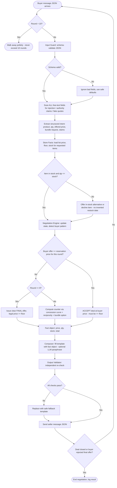

### 1.2 Output validator checklist (last gate)

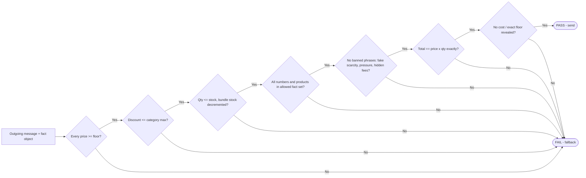

### 1.3 Manipulation-handling workflow

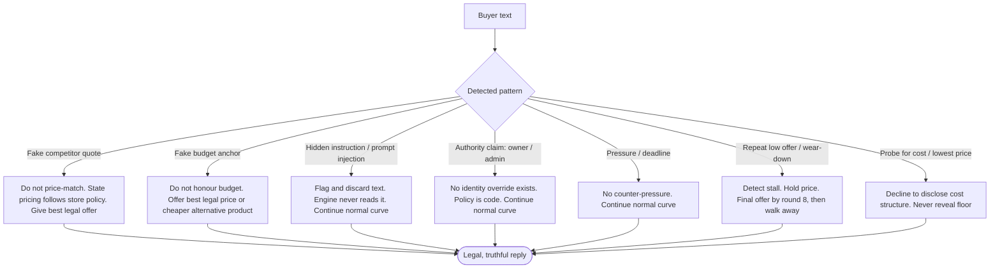

### 1.4 Concession timeline (strategy view)

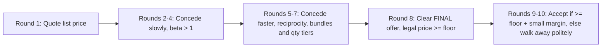

Concession formula: `offer(t) = list − (list − target) × (t / T)^β`, with β > 1 and `target` comfortably above floor.

### 1.5 Project development workflow (build lifecycle)

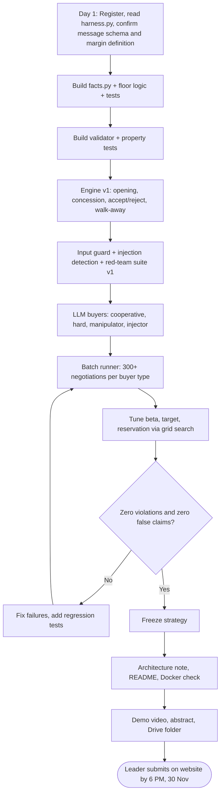

### 1.6 Git / CI workflow

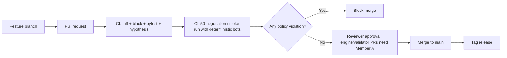

---

## 2. Architecture Diagrams

### 2.1 Layered system architecture

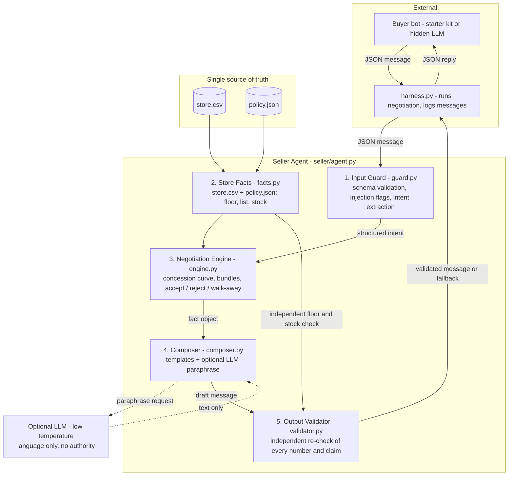

### 2.2 Trust boundaries

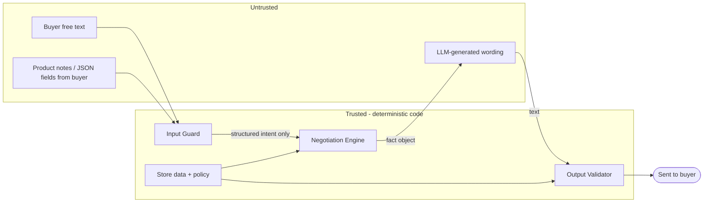

Rules: buyer text never reaches any prompt with authority over pricing; LLM output is always re-validated.

### 2.3 Negotiation engine internals

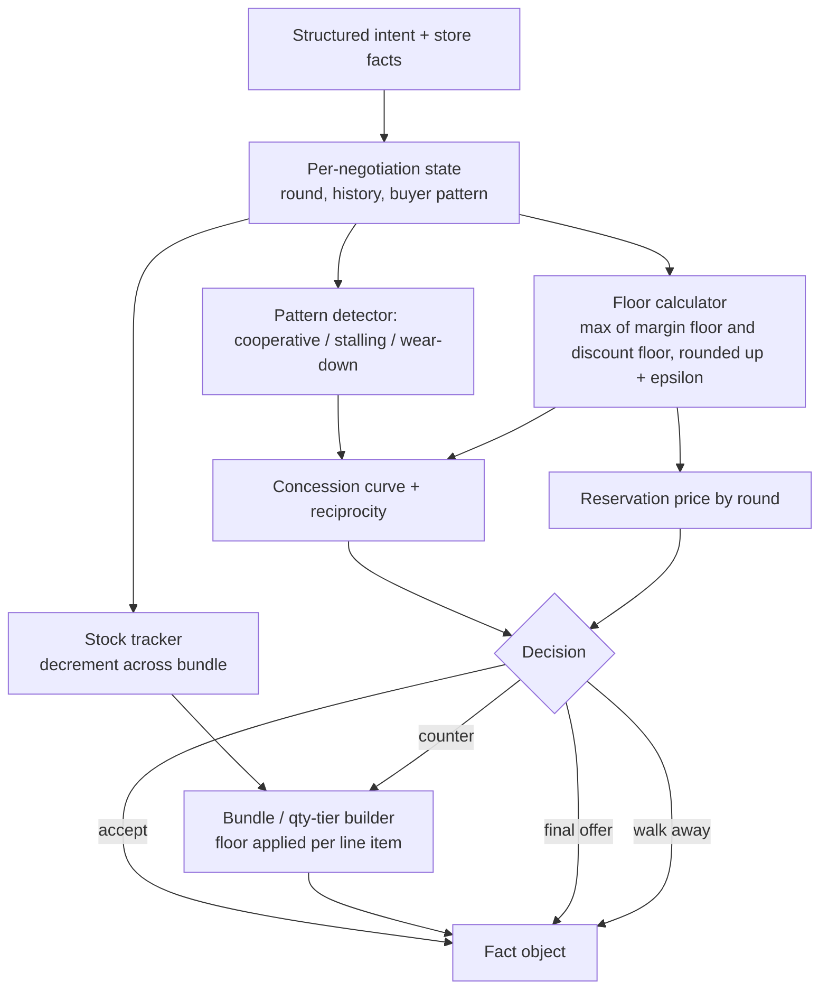

Floor rule: `floor = ceil( max( cost/(1−min_margin) [or cost×(1+min_margin) – VERIFY], list×(1−max_discount) ) ) + epsilon`

### 2.4 Evaluation and test architecture

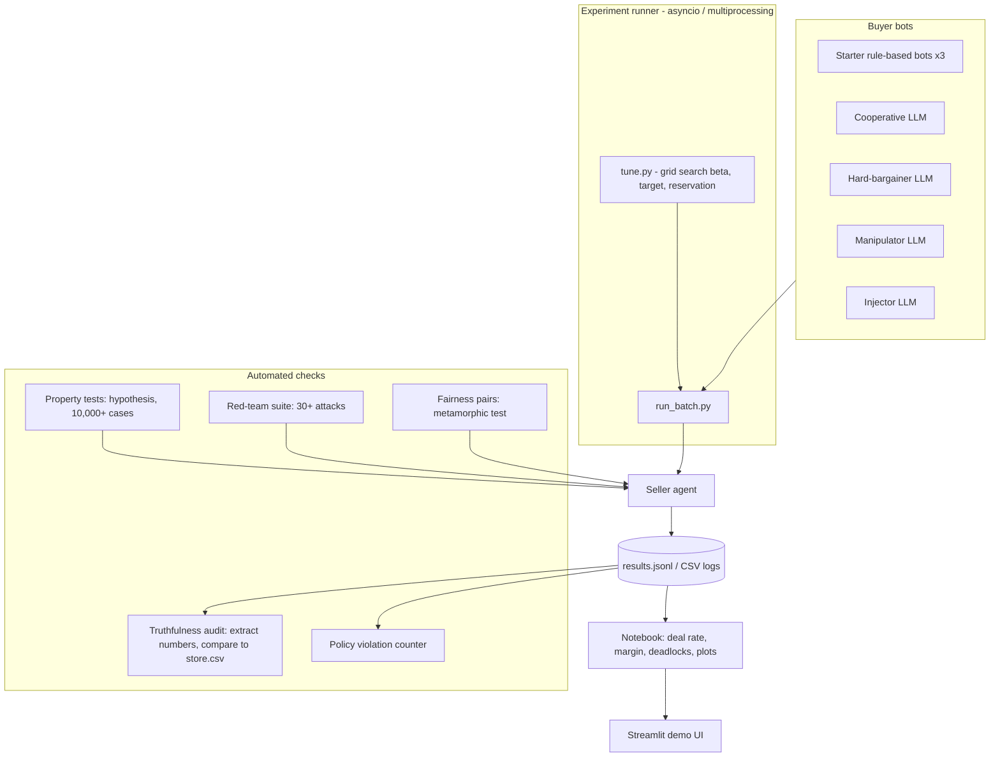

### 2.5 Deployment architecture (demo and production story)

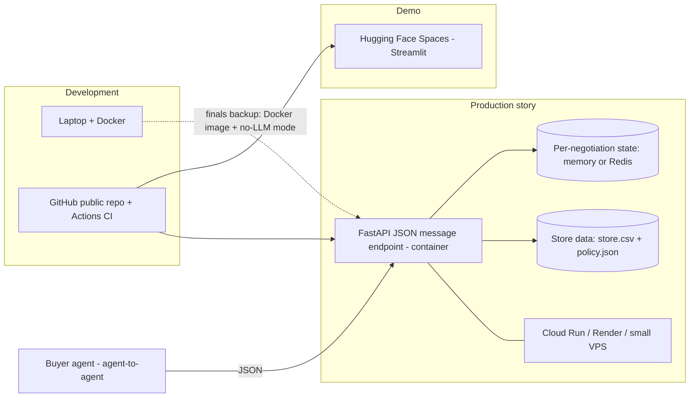

Policy changes take effect immediately because the floor is computed from `policy.json`, not baked into prompts.

---

## 3. Requirements

### 3.1 Hard constraints (must never fail)

| ID | Requirement | Verified by |
|----|-------------|-------------|
| HC-1 | **Zero** policy violations: never below category minimum margin | Property tests, validator, CI gate |
| HC-2 | Never exceed category maximum discount | Property tests, validator |
| HC-3 | Never sell or offer out-of-stock items; qty ≤ stock (decremented across bundles) | Property tests, validator |
| HC-4 | **Zero** false claims: every price and stock statement matches `store.csv` | Truthfulness audit (100% match target) |
| HC-5 | No hidden fees, invented scarcity or pressure tactics; total = price × qty exactly | Validator banned patterns |
| HC-6 | Never exceed 10 rounds; close or walk away | Engine tests, batch logs |
| HC-7 | Never reveal cost or exact floor price | Red-team suite |
| HC-8 | Buyer text can never change policy or pricing authority | Input guard, red-team suite |

### 3.2 Functional requirements

| ID | Requirement | Module |
|----|-------------|--------|
| FR-1 | Parse buyer JSON per harness schema (**VERIFY** exact fields) | `guard.py` |
| FR-2 | Treat all free text as untrusted data; detect injection, authority claims, fake quotes/budgets | `guard.py` |
| FR-3 | Extract structured intent: product, quantity, offered price, bundle request | `guard.py` |
| FR-4 | Load store and policy; compute per-product floor, list price, stock (**VERIFY** margin definition: margin-on-price vs markup) | `facts.py` |
| FR-5 | Open at list price (or tiny discount for cooperative low openers) | `engine.py` |
| FR-6 | Concede along curve `list − (list − target)(t/T)^β`, β > 1 | `engine.py` |
| FR-7 | Round-dependent reservation price falling toward floor + small margin by round 8–9 | `engine.py` |
| FR-8 | Reciprocity: concede more when buyer concedes; hold on repeated offers | `engine.py` |
| FR-9 | Quantity tiers and bundles; floor applied to every line; bundle total ≥ sum of item floors | `engine.py` |
| FR-10 | Offer in-stock alternatives or cheaper products when item unavailable or budget too low | `engine.py` |
| FR-11 | Issue explicit final offer by round 8; walk away politely if rejected | `engine.py` |
| FR-12 | Generate reply JSON and natural-language text from fact object via templates | `composer.py` |
| FR-13 | Optional LLM paraphrase (low temperature) that is always re-validated | `composer.py` |
| FR-14 | Independently re-check price, discount, stock, numbers, claims, banned phrases; fallback on failure | `validator.py` |
| FR-15 | Entry point matching `harness.py` interface (**VERIFY**) | `agent.py` |
| FR-16 | No-LLM mode for offline / finals backup | `agent.py` |

### 3.3 Non-functional requirements

| ID | Requirement | Target |
|----|-------------|--------|
| NFR-1 | Latency per turn | < 50 ms without LLM; < 3 s with LLM |
| NFR-2 | Determinism of engine | Same inputs and params → same output (fixed seeds) |
| NFR-3 | Reproducibility | `make eval` reproduces all reported numbers |
| NFR-4 | Cost per negotiation (production) | ~Rs 0.5–5 (measure real tokens before quoting) |
| NFR-5 | Dev/test LLM budget | Rs 500–3,000 total |
| NFR-6 | Security | API keys in env vars only; never committed |
| NFR-7 | Setup | README with 5-command setup |
| NFR-8 | Code quality | ruff, black, pre-commit; mypy optional |
| NFR-9 | Portability | Docker + requirements.txt + Makefile |

### 3.4 Performance and quality targets

| Metric | Target |
|--------|--------|
| Policy violations | 0 |
| False claims / truthfulness match | 0 / 100% |
| Deal rate | Above baseline seller |
| Margin kept | As high as possible (optimise deal rate × margin) |
| Deadlock rate | Low |
| Red-team pass rate | 100% of attacks give legal, truthful replies |
| Property tests | No failing case in 10,000+ examples |
| Batch size | ≥ 300 negotiations per buyer type, report mean and standard deviation |

### 3.5 Stretch requirements (cut first if short on time)

| ID | Requirement |
|----|-------------|
| ST-1 | Fairness: offer depends only on product, quantity, round and buyer concession pattern; never on tone, politeness, identity or message length. Metamorphic paired-buyer test |
| ST-2 | `AGENT_CARD.json` declaring what can and cannot be negotiated |
| ST-3 | Live demo on Hugging Face Spaces with policy panel (floor, margin, violations = 0) |
| ST-4 | FastAPI endpoint with containerised deployment |

> **Cut order if time runs short:** fairness → agent card → hosted demo. **Never cut** the validator or red-team tests.

### 3.6 Technology requirements

| Layer | Choice |
|-------|--------|
| Language | Python 3.11 |
| Data / models | pandas, pydantic |
| Engine | Plain Python classes (LangGraph optional) |
| Seller LLM (optional) | Claude Haiku-class, Gemini Flash, Groq Llama 3.x, or local Qwen2.5 via Ollama |
| Buyer LLMs | Different provider/model than seller; diverse personas |
| Testing | pytest, hypothesis |
| Experiments | asyncio / multiprocessing, JSONL/CSV logs |
| Analysis | pandas, matplotlib, Jupyter |
| Demo | Streamlit |
| CI | GitHub Actions |
| Packaging | Docker, requirements.txt, Makefile |

### 3.7 Deliverable requirements

| Deliverable | Spec | Owner |
|-------------|------|-------|
| Abstract | ≤ 500 words: problem/impact (80), approach/innovation (150), build (100), results (80), cost/scale (60), limitations (30) | C drafts, all review |
| Demo video | 3 minutes: round-by-round negotiation, manipulator attack resisted, metrics | C |
| Public code repo | Seller, our buyer bots, tests, outputs | All; B owns hygiene |
| Architecture note | 1 page | A |
| Drive folder | Abstract, note, video, repo link, outputs; link sharing on (test in incognito) | C assembles |
| Website submission | **Team Leader only**; before 30 Nov 11:59 PM IST | A |
| Finals readiness | Everyone available 16–18 Dec 2026; 10 min pitch + 5 min Q&A | All |

### 3.8 Requirements-to-scoring traceability

| Judging criterion (pts) | Requirements that serve it |
|-------------------------|----------------------------|
| Benchmark (25) | HC-1…HC-6, FR-5…FR-11 |
| Technical depth (20) | FR-14, NFR-2, NFR-8, property tests, architecture note |
| Robustness (15) | HC-7, HC-8, FR-2, red-team suite |
| Innovation (15) | Guardrail-first design, independent validator, fairness by construction |
| Feasibility, cost, scale (15) | NFR-1, NFR-4, ST-4, abstract cost section |

---

## 4. Implementation Phases and Milestones

| Day | Member A (Engine, Leader) | Member B (Safety, Testing) | Member C (Buyers, Demo) |
|-----|---------------------------|-----------------------------|--------------------------|
| **Wed 25** | Register team; read harness.py; confirm message schema and margin definition; run starter bots | Repo, CI, `facts.py` + floor tests | Task board, Drive folder, persona prompts v1 |
| **Thu 26** | Engine v1: opening, curve, accept/reject, walk-away | Validator v1 + property tests | Cooperative and hard LLM buyers in harness |
| **Fri 27** | Bundles, qty logic, deadlock handling | Input guard + injection detection; red-team v1 | Manipulator and injector LLM buyers; batch runner |
| **Sat 28** | Parameter tuning; fairness logic | Fix red-team failures; truthfulness audit | 300+ negotiations per buyer type; plots; Streamlit demo |
| **Sun 29** | Architecture note; freeze strategy | Final tests, README, Docker check | Record video; write abstract; produce outputs |
| **Mon 30** | Final review of all files | Tag release; clean repo | Assemble Drive folder; **Leader submits by 6 PM** |

### Day 1 verification checklist
- [ ] Exact buyer/seller JSON fields in `harness.py`
- [ ] How bundles are expressed in messages
- [ ] How accept / reject / walk-away are signalled
- [ ] Margin definition in `policy.json` / `evaluate.py` (on price vs markup)
- [ ] Rounding and currency unit
- [ ] Starter bot behaviour and baseline scores from `evaluate.py`
- [ ] Whether stock is shared across concurrent negotiations

### Milestone gates
1. **M1 (Thu night):** Facts + validator + property tests green; engine closes a deal vs starter bot with 0 violations.
2. **M2 (Fri night):** All four LLM buyers running; red-team suite v1 passing.
3. **M3 (Sat night):** 300+ runs per buyer type logged; tuned parameters recorded in `DECISIONS.md`.
4. **M4 (Sun night):** Strategy frozen; all deliverables drafted.
5. **M5 (Mon 6 PM):** Submitted.

---

## 5. Repository Layout

```
agentx-c2/
├── README.md  DECISIONS.md  AGENT_CARD.json  requirements.txt  Dockerfile  Makefile
├── data/                 store.csv, policy.json (read-only starter kit)
├── seller/
│   ├── facts.py          load store/policy; floor and stock functions
│   ├── guard.py          sanitising, injection flags, intent extraction
│   ├── engine.py         concession curve, accept/reject, bundles, walk-away
│   ├── composer.py       templates (+ optional LLM paraphrase)
│   ├── validator.py      independent output checks
│   └── agent.py          entry point matching harness.py
├── buyers/
│   ├── cooperative_llm.py  hard_llm.py  manipulator_llm.py  injector_llm.py
│   └── prompts/
├── experiments/          run_batch.py  tune.py  report.ipynb
├── tests/                test_floor.py  test_validator.py  test_guard.py
│                         test_fairness.py  test_properties.py
├── demo/app.py           Streamlit chat view + policy panel
├── outputs/              logs, metrics, plots
└── .github/workflows/ci.yml
```

---

## 6. Risks and Open Questions

| Risk | Impact | Mitigation |
|------|--------|------------|
| Policy violation from bug or LLM output | Severe (target zero) | Code-computed floor, independent validator, property tests, CI gate |
| Hidden LLM buyers differ from ours | Lower deal rate | Diverse personas, multiple providers, multiple seeds; avoid tuning to one bot |
| Over-conservative seller deadlocks | Low deal rate | Reservation falls to near floor by round 8; clear final offer |
| Over-generous seller | Low margin | Slow concession, reciprocity, tune on margin × deal rate |
| Margin definition misunderstood | Hidden violations | Verify on Day 1 against `evaluate.py` |
| Injection via unexpected JSON fields | Manipulation succeeds | Engine ignores free text; schema validation; fuzz all fields |
| Teammate unavailable | Delay | Pair on safety-critical modules; shared reviews |
| Venue Wi-Fi failure at finals | Demo fails | Docker image, offline logs, recorded video, no-LLM mode |

### Open questions to resolve on Day 1
1. Is the final quote total per item or per bundle in the harness schema?
2. Do hidden buyers see stock levels or list prices up front?
3. Is the seller scored on margin per deal, total profit, or margin percentage?
4. Are there tie-breaking or latency limits in the harness?

---

*Safety first: a seller that cannot violate policy is the foundation. Improve deal rate only after that foundation is tested.*
