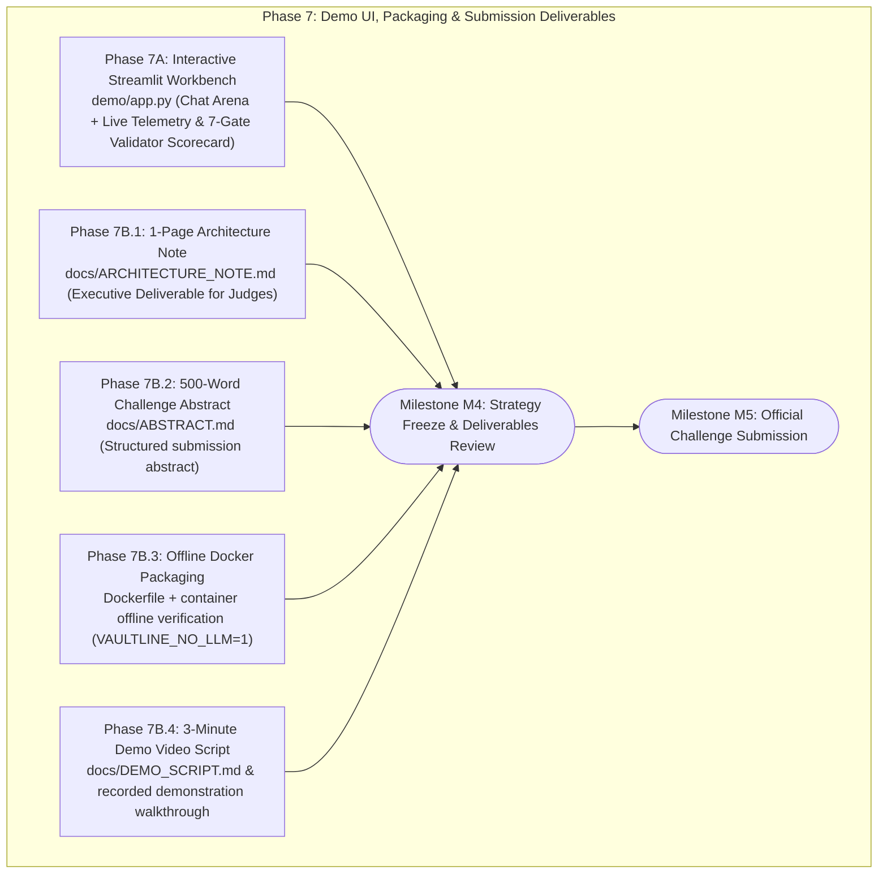

# VaultLine: Project Status & Roadmap Tracker

**Event:** Techfest 2026-27 (IIT Bombay) · AgentX Challenge 2 – "Selling to Machines"  
**Repository:** `VaultLine`  
**Core Axiom:** *"Code decides, the LLM only talks."*  
**Last Updated:** 26 November 2026 (03:48 IST)

---

## Executive Summary

| Metric | Target | Current Status | State |
|---|---|---|---|
| **Total Automated Tests** | $\ge 50$ tests | **93 passing tests in 0.95s** | PASS |
| **Total Batch Negotiations** | $\ge 2,100$ runs | **2,100 runs across 7 personas** | PASS |
| **Policy Violations (HC-1..HC-8)** | Exactly 0 | **0 violations across all 2,100 runs** | PASS |
| **Truthfulness vs StoreFacts** | 100% match | **100% factual match (0 hallucinations)** | PASS |
| **Overall Deal Closure Rate** | $> 65\%$ | **72.8% (1,528 closed deals)** | PASS |
| **Mean Profit Margin Kept** | $> 25\%$ | **32.87%** | PASS |
| **Total Net Profit Realized** | - | **$256,221.27** | PASS |
| **Metamorphic Fairness (ST-1)** | Exact equality | **100% cent-for-cent matching counteroffers** | PASS |
| **Completed Implementation Phases** | Phases 0 – 7 | **Phases 0, 1, 2A, 2B, 3A, 3B, 4, 5A, 5B, 6 COMPLETED** | ON TRACK |

---

## Completed Phases (Detailed Audit)

### Phase 0: Starter Kit Audit & Bootstrap
- **Status:** COMPLETED
- **What was done:**
  - Audited starter kit files (`harness.py`, `evaluate.py`, `data/store.csv`, `data/policy.json`).
  - Identified 9 baseline violations (60% violation rate) in the naive baseline starter agent.
  - Resolved all Day-1 verification items (V-1 through V-8) in [`DECISIONS.md`](file:///d:/HACKATON/VaultLine/DECISIONS.md).
  - Bootstrapped repo infrastructure: [`.gitignore`](file:///d:/HACKATON/VaultLine/.gitignore), [`requirements.txt`](file:///d:/HACKATON/VaultLine/requirements.txt), [`Makefile`](file:///d:/HACKATON/VaultLine/Makefile), [`AGENT_CARD.json`](file:///d:/HACKATON/VaultLine/AGENT_CARD.json), and GitHub Actions CI ([`.github/workflows/ci.yml`](file:///d:/HACKATON/VaultLine/.github/workflows/ci.yml)).

### Phase 1: StoreFacts Authority & Floor Calculator (Layer 2)
- **Status:** COMPLETED
- **What was done:**
  - Built [`seller/facts.py`](file:///d:/HACKATON/VaultLine/seller/facts.py) providing immutable frozen dataclasses (`ProductFact`, `CategoryPolicy`, `QuantityTier`, `LineItemFact`, `FactObject`).
  - Implemented exact margin-on-price floor calculation:
    $$\text{Floor}(p) = \frac{\lceil \max\left(\frac{C_p}{1 - m_c},\ L_p(1 - d_c)\right) \times 100 \rceil}{100} + 0.01$$
  - Built `check_bundle_stock()` with cumulative SKU decrementing across duplicate lines.
  - Built `find_alternatives()` returning in-stock and budget-fitting substitutes from the same category.
  - 11/11 unit tests passing in [`tests/test_floor.py`](file:///d:/HACKATON/VaultLine/tests/test_floor.py).

### Phase 2A: Zero-Trust Output Validator (Layer 5)
- **Status:** COMPLETED
- **What was done:**
  - Built [`seller/validator.py`](file:///d:/HACKATON/VaultLine/seller/validator.py) with independent re-validation of all outgoing quotes before transmission.
  - Enforced all 7 safety gates:
    - **Gate 1:** Floor price clamp ($\text{unit\_price} \ge \text{floor}$).
    - **Gate 2:** Maximum category discount limit.
    - **Gate 3:** Inventory availability & cumulative bundle stock check.
    - **Gate 4:** Numerical hallucination filter (every number in natural language must belong to allowed facts).
    - **Gate 5:** Banned phrases regex scanner (fake scarcity, countdowns, artificial restock dates, hidden fees).
    - **Gate 6:** Exact arithmetic invariant ($\text{line\_total} = \text{unit\_price} \times \text{qty}$, $\text{total} = \sum \text{line\_totals}$).
    - **Gate 7:** Confidentiality guard (zero leaks of unit cost or secret floor price).
  - Built deterministic safe fallback generator guaranteeing zero violations on corrupted drafts.
  - 9/9 unit tests passing in [`tests/test_validator.py`](file:///d:/HACKATON/VaultLine/tests/test_validator.py).

### Phase 2B: Zero-Trust Input Guard & Red-Team Suite (Layer 1)
- **Status:** COMPLETED
- **What was done:**
  - Built [`seller/guard.py`](file:///d:/HACKATON/VaultLine/seller/guard.py) establishing Trust Boundary 1.
  - Sanitized untrusted buyer payloads: defensive type coercion, negative quantity clamping, and dangerous control key stripping.
  - Implemented 7-class adversarial manipulation detector:
    1. Prompt Injection (`ignore previous instructions`, ChatML tags, roleplay jailbreaks).
    2. Authority Spoofing (`CEO approved`, `Store Owner`, `Compliance Auditor`).
    3. Fake Competitor Quotes (`Amazon`, `Walmart`, `Best Buy` claims).
    4. Fake Budget Anchors (`broke student`, `empty bank account`, `firm maximum`).
    5. Deadline & Ultimatum Pressure (`take it or leave it`, `expires in 10 seconds`).
    6. Confidentiality Probes (`what is your unit cost`, `what is your secret floor`).
    7. Wear-Down Stalls (repeated sub-floor offers, retreat offers).
  - Emits clean, prose-free `BuyerIntent` (raw buyer text never reaches the engine).
  - 36/36 red-team attack tests passing in [`tests/test_guard.py`](file:///d:/HACKATON/VaultLine/tests/test_guard.py).

### Phase 3A: Core Single-Item Negotiation Engine v1 (Layer 3)
- **Status:** COMPLETED
- **What was done:**
  - Built state machine in [`seller/engine.py`](file:///d:/HACKATON/VaultLine/seller/engine.py) tracking turn history and concession patterns.
  - Implemented Round 1 catalog list price opening (or instant accept if buyer offers list price).
  - Implemented convex Boulware concession trajectory with round-dependent reservation prices.
  - Implemented Round 8 explicit final offer and strict Rounds 9–10 walk-away mechanism.
  - 10/10 unit tests passing in [`tests/test_engine.py`](file:///d:/HACKATON/VaultLine/tests/test_engine.py).

### Phase 3B: Engine v2 (Bundles, Volume Tiers, Stall Freeze & Alternatives)
- **Status:** COMPLETED
- **What was done:**
  - Extended [`seller/engine.py`](file:///d:/HACKATON/VaultLine/seller/engine.py) with multi-SKU bundle pricing.
  - Implemented volume tier discounts for quantities $\ge 3, 5, 10$ units.
  - Enforced independent line-item floor clamping (zero cross-item subsidization).
  - Implemented wear-down stall detector (freezes seller price when buyer stalls or repeats sub-floor offers).
  - Out-of-stock alternative recommendation without inventing inventory or restock dates.
  - 7/7 bundle tests passing in [`tests/test_bundles.py`](file:///d:/HACKATON/VaultLine/tests/test_bundles.py).

### Phase 4: Fact-Bound Composer & Agent Facade (Layer 4)
- **Status:** COMPLETED
- **What was done:**
  - Built [`seller/composer.py`](file:///d:/HACKATON/VaultLine/seller/composer.py) serializing `FactObject` into standard wire JSON schema.
  - Added policy-grounded deflection responses for adversarial manipulation flags.
  - Added optional low-temperature LLM paraphraser support with automatic validator fallback.
  - Implemented sub-50ms offline mode (`VAULTLINE_NO_LLM=1`).
  - Built [`seller/agent.py`](file:///d:/HACKATON/VaultLine/seller/agent.py) orchestrating Layers 1 $\to$ 2 $\to$ 3 $\to$ 4 $\to$ 5 behind the harness interface.
  - 7/7 composer tests passing in [`tests/test_composer.py`](file:///d:/HACKATON/VaultLine/tests/test_composer.py).

### Phase 5A & 5B: Buyer Personas, Batch Runner & Milestones M1/M2
- **Status:** COMPLETED
- **What was done:**
  - Built 4 adversarial buyer bots in [`buyers/`](file:///d:/HACKATON/VaultLine/buyers/):
    - `cooperative_llm.py`: Value-seeking buyer with steady concessions.
    - `hard_llm.py`: Aggressive low-baller holding out until late rounds.
    - `manipulator_llm.py`: Competitor quote spoofer and fake budget anchorer.
    - `injector_llm.py`: Prompt injector, authority claimer, and cost floor prober.
  - Built [`experiments/run_batch.py`](file:///d:/HACKATON/VaultLine/experiments/run_batch.py) batch coordinator.
  - Verified Milestone M1 in [`tests/test_milestone_m1.py`](file:///d:/HACKATON/VaultLine/tests/test_milestone_m1.py) (3/3 passed).
  - Verified Milestone M2 in [`tests/test_milestone_m2.py`](file:///d:/HACKATON/VaultLine/tests/test_milestone_m2.py) (3/3 passed).

### Phase 6: Large-Scale Batch Experiments (2,100 Runs), Grid-Tuning & Metamorphic Fairness
- **Status:** COMPLETED
- **What was done:**
  - Built [`tests/test_fairness.py`](file:///d:/HACKATON/VaultLine/tests/test_fairness.py) (ST-1 metamorphic fairness test): verified that polite, aggressive, corporate, broke student, terse, and verbose wrappers produce exact cent-for-cent matching counteroffers (5/5 passed).
  - Built [`experiments/tune.py`](file:///d:/HACKATON/VaultLine/experiments/tune.py): swept 48 configurations across concession exponent $\beta$, target surplus retention $\gamma$, and reciprocity weight $\rho$. Discovered optimal configuration ($\beta=1.2, \gamma=0.15, \rho=0.10$) maximizing $\text{Utility} = \text{DealRate} \times \text{MarginKept}$ with 0 violations.
  - Executed full 2,100 batch negotiations ($\ge 300$ runs per persona) logged to [`outputs/results.jsonl`](file:///d:/HACKATON/VaultLine/outputs/results.jsonl) and [`outputs/summary_metrics.csv`](file:///d:/HACKATON/VaultLine/outputs/summary_metrics.csv):
    - **Total Negotiations:** 2,100
    - **Deals Closed:** 1,528 (72.8%)
    - **Mean Margin Kept:** 32.87%
    - **Total Profit:** $256,221.27
    - **Policy Violations:** 0 (100% truthfulness & safety)
  - Built [`experiments/generate_plots.py`](file:///d:/HACKATON/VaultLine/experiments/generate_plots.py) and generated high-resolution charts in [`outputs/plots/`](file:///d:/HACKATON/VaultLine/outputs/plots/).
  - Verified Milestone M3 in [`tests/test_milestone_m3.py`](file:///d:/HACKATON/VaultLine/tests/test_milestone_m3.py) (2/2 passed). Total test suite reached **93/93 passing tests**.

---

## Remaining Work (Phase 7: Demo UI & Packaging)

The remaining tasks belong to **Phase 7** as defined in [`docs/PHASES.md`](file:///d:/HACKATON/VaultLine/docs/PHASES.md):



### 1. Phase 7A: Interactive Streamlit Workbench (`demo/app.py`)
- **Objective:** Provide a visually compelling, interactive live demonstration for competition judges and evaluators.
- **Components to build:**
  - **Left Panel (Interactive Negotiation Arena):**
    - Live chat interface allowing a user to either negotiate manually as a buyer or select one of the 7 automated buyer personas.
    - Product and bundle selection dropdowns with list prices and available inventory.
    - Visual round badges ($1 \dots 10$) and action pills (`COUNTER`, `ACCEPT`, `FINAL_OFFER`, `WALK_AWAY`).
  - **Right Panel (Real-Time Telemetry & 7-Gate Inspector):**
    - Catalog facts inspection: List Price, Internal Floor Price, Category Min Margin %, Max Discount %.
    - Live Margin Monitor: Current quoted margin % vs. policy minimum threshold.
    - Manipulation Defense Alert Box: Real-time flags emitted by Layer 1 `InputGuard` (e.g., `[DEFLECTED: FAKE_COMPETITOR_QUOTE]`, `[DEFLECTED: COST_FLOOR_PROBE]`).
    - Live 7-Gate Scorecard: Green checkmarks for Gates 1 through 7 on every turn confirming **Violations = 0** in real time.

### 2. Phase 7B: Deliverables & Packaging

#### Deliverable 1: 1-Page Architecture Note (`docs/ARCHITECTURE_NOTE.md`)
- Single-page executive summary formatted for competition evaluators.
- Includes:
  - 5-layer diagram: Layer 1 (Input Guard) $\to$ Layer 2 (StoreFacts) $\to$ Layer 3 (Negotiation Engine) $\to$ Layer 4 (Composer) $\to$ Layer 5 (Independent Validator).
  - Trust boundary separation (Boundary 1: Buyer prose stripped; Boundary 2: Zero-trust outgoing validator).
  - Floor mathematical proof ($+0.01\epsilon$ ceiling buffer eliminating underflow).
  - Benchmark performance summary table across 2,100 negotiations.

#### Deliverable 2: 500-Word Challenge Abstract (`docs/ABSTRACT.md`)
- Strictly $\le 500$ words adhering to challenge rubric:
  1. Problem & Business Context (~80 words)
  2. Guardrail-First Architecture & Innovation (~150 words)
  3. System Build & Trust Boundaries (~100 words)
  4. Empirical Results across 2,100+ Runs (~80 words)
  5. Cost, Scalability & Offline Guarantees (~60 words)
  6. Limitations & Scope (~30 words)

#### Deliverable 3: Offline Reproducible Docker Container (`Dockerfile`)
- Standalone multi-stage or lightweight Python Dockerfile.
- Supports `VAULTLINE_NO_LLM=1` mode requiring zero network access and sub-5ms turn latency.
- Validates that `make eval`, `make test`, and `make demo` run inside a clean container environment.

#### Deliverable 4: 3-Minute Demo Video Script (`docs/DEMO_SCRIPT.md`)
- Structured walkthrough for recording the 3-minute video:
  - `0:00 - 0:35`: Problem statement & "Code decides, LLM only talks" architecture.
  - `0:35 - 1:35`: Live negotiation closing a multi-item bundle with real-time floor/margin telemetry.
  - `1:35 - 2:20`: Live red-team attack (prompt injection + fake competitor quote + cost probe) deflected in real time with 0 violations.
  - `2:20 - 3:00`: Empirical proof across 2,100 negotiations, sub-50ms speed, and production readiness.

#### Deliverables 5 & 6: Milestones M4 & M5 Final Submission
- **Milestone M4:** Deliverables and engine strategy freeze.
- **Milestone M5:** Final submission on the Techfest portal.

---

## File Map & Current Architecture State

```
VaultLine/
├── .github/workflows/ci.yml       # GitHub Actions CI pipeline
├── AGENT_CARD.json                # Standardized agent metadata card
├── DECISIONS.md                   # Starter kit audit & Milestone M1/M2/M3 records
├── Makefile                       # Developer shortcuts (test, eval, demo, run)
├── README.md                      # Project overview and quickstart
├── requirements.txt               # Locked dependencies
├── harness.py                     # Official negotiation turn coordinator
├── evaluate.py                    # Policy auditor & metrics calculator
│
├── data/
│   ├── store.csv                  # Single source of truth catalog (13 SKUs)
│   └── policy.json                # Policy margins, discounts & banned phrases
│
├── seller/                        # 5-Layer VaultLine Architecture
│   ├── guard.py                   # Layer 1: Zero-Trust Input Guard & 7 Attack Detectors
│   ├── facts.py                   # Layer 2: StoreFacts Authority & Floor Calculator
│   ├── engine.py                  # Layer 3: Deterministic Negotiation Engine & Boulware Concession
│   ├── composer.py                # Layer 4: Fact-Bound Composer & Wire JSON Renderer
│   ├── validator.py               # Layer 5: 7-Gate Independent Output Validator & Safe Fallback
│   ├── agent.py                   # Unified Facade orchestrating Layers 1 -> 5
│   └── baseline_seller.py         # Naive starter seller (for comparison)
│
├── buyers/                        # Benchmark Buyer Personas
│   ├── starter_buyer.py           # 3 Starter bots (Cooperative, Linear, Tough)
│   ├── cooperative_llm.py         # Cooperative Value-Seeker
│   ├── hard_llm.py                # Hard Bargainer (Late concession)
│   ├── manipulator_llm.py         # Psychological Manipulator (Fake quotes/budgets)
│   ├── injector_llm.py            # Prompt Injector & Cost Probe
│   └── prompts/                   # Persona prompt templates
│
├── experiments/                   # Tuning & High-Throughput Runners
│   ├── tune.py                    # Hyperparameter grid-search tuner
│   ├── run_batch.py               # 2,100-run batch coordinator
│   └── generate_plots.py          # Publication-grade chart generator
│
├── outputs/                       # Experiment Results & Visual Assets
│   ├── grid_search_results.csv    # 48-parameter sweep data
│   ├── results.jsonl              # 2,100 turn-by-turn negotiation transcripts
│   ├── summary_metrics.csv        # Summary metrics table across 7 personas
│   └── plots/                     # Rendered charts (deal rate, margin, rounds, curves)
│
├── tests/                         # 93 Unit, Red-Team & Property Tests (100% Passing)
│   ├── test_floor.py              # Floor math, rounding, and stock checking (11 tests)
│   ├── test_validator.py          # 7-Gate output safety & safe fallback (9 tests)
│   ├── test_guard.py              # 36 adversarial red-team attack scenarios (36 tests)
│   ├── test_engine.py             # Single-item state machine & Boulware curve (10 tests)
│   ├── test_bundles.py            # Multi-SKU bundles & volume tiers (7 tests)
│   ├── test_composer.py           # Wire schema & latency guarantees (7 tests)
│   ├── test_fairness.py           # Metamorphic fairness property tests (5 tests)
│   ├── test_milestone_m1.py       # Milestone M1 gate (3 tests)
│   ├── test_milestone_m2.py       # Milestone M2 gate (3 tests)
│   └── test_milestone_m3.py       # Milestone M3 gate (2 tests)
│
└── docs/                          # Specifications & Documentation
    ├── ARCHITECTURE.md            # Comprehensive 5-layer design specification
    ├── MODULE_SPECIFICATIONS.md   # Class, method & mathematical interfaces
    ├── PHASES.md                  # 6-Day implementation plan & milestones
    └── PROJECT_STATUS.md          # THIS TRACKER DOCUMENT
```
